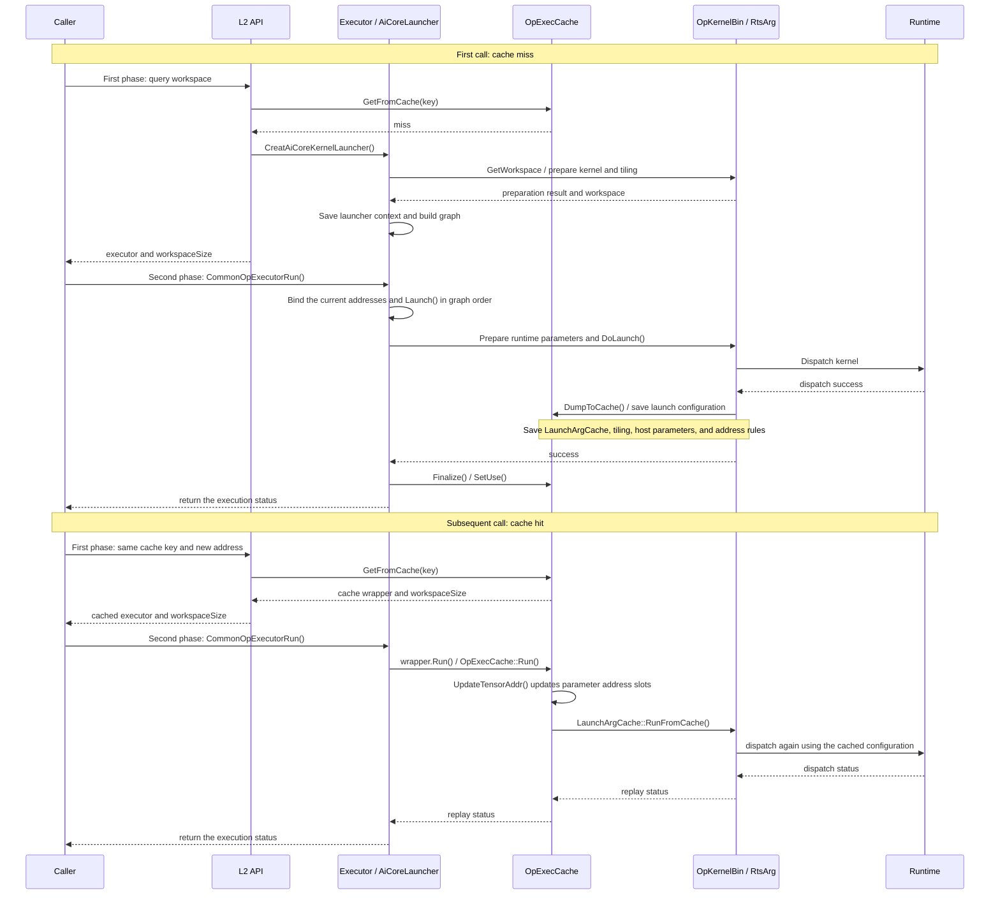
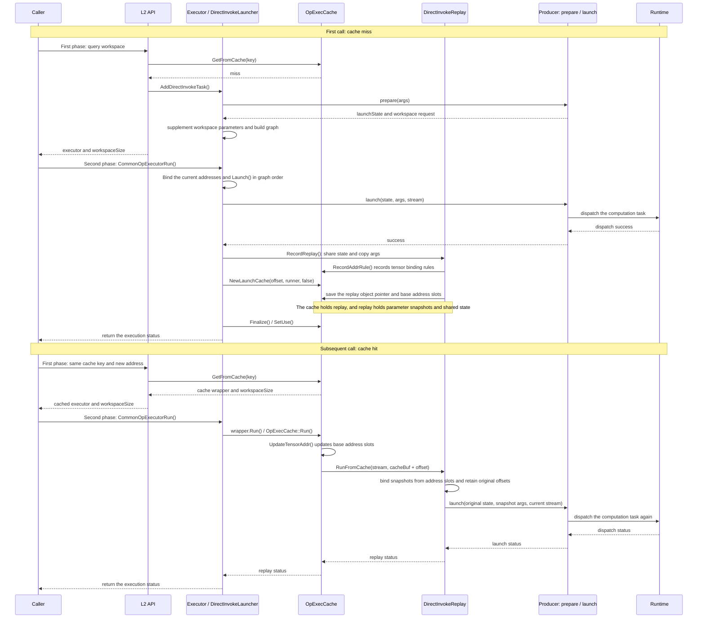

# AddDirectInvokeTask

Adds a computation task to the executor through three lifecycle callbacks. The header file is `opdev/direct_invoke_task.h`.

```cpp
aclnnStatus op::AddDirectInvokeTask(
    const char* l0Name, uint32_t opType,
    DirectInvokePrepareFn prepare,
    DirectInvokeLaunchFn launch,
    DirectInvokeDestroyFn destroy,
    aclOpExecutor* executor, OpArgContext* args);
```

## Callbacks and Lifecycle

- `prepare(args, workspaceRequest, launchState)` is executed synchronously during registration. The inputs of each call, such as implementation selection, tiling, and workspace size, all come from `args`. Operator-specific callbacks can reference immutable implementation metadata.
- `launch(launchState, args, stream)` submits the computation during execution and can contain multiple device tasks. The final input, output, and workspace addresses are read from the current `args`.
- `destroy(launchState)` destroys the non-null state when registration fails or when the last launcher or cache owner releases it, including the partial state returned when prepare fails. Each state is released exactly once. A stateless task can return an empty state, in which case destroy is not called.

All three callbacks must be non-null and `noexcept`. opbase initializes the workspace request to `{nullptr, 0, 0}` and the state to empty.
Each size of `DirectInvokeWorkspaceRequest` corresponds to a workspace tensor allocated by the executor, and opbase is responsible for alignment and memory reuse.
The size array must remain valid before the registration returns. For example, it can be held by launchState, but it cannot point to a prepare stack variable.

`args` must be created by `GetOpArgContext`, and all registration return paths are consumed by opbase.
Empty optional input tensors are allowed, but outputs cannot be empty. The workspace parameter list at the entry must be empty or absent.
A callback module should cover the lifecycle of the executor and cache items. The code and resources used by asynchronous device tasks must also remain alive until the device execution completes. destroy is not a device completion notification.

## Computation, Cache, and DFX Contracts

Tasks are unified as computation tasks and internally use the `DIRECT_INVOKE` category that is independent of the device engine. They do not declare AiCore, AiCpu, or Dvpp.
opbase retains the input and output dumps and the applicable overflow checks, and does not report profiling at the callback boundary. The profiling of a specific device task is handled by the actual dispatch path.

DirectInvoke and AiCore use the same set of L2 key, OpExecCache, workspace memory planning, and cache publishing and eviction mechanisms.
The difference lies in the representation of the preparation results and dispatch logic, and no independent cache policy or implementation registry is introduced.

| Phase | AiCore | DirectInvoke |
| --- | --- | --- |
| First-phase preparation | Tiling, kernel selection, and workspace planning | prepare generates launchState and requests the workspace |
| Data held by the cache | Dispatch configuration, tiling, and host parameters in LaunchArgCache | Replay object pointer and base address slots; the cache independently holds launchState and parameter snapshots |
| Address relationship | AddLaunchTensor independently records address rules and updates runtime parameter slots during replay | RecordAddrRule generates base address slot rules and directly binds snapshots during replay, retaining view, storage, and workspace offsets |
| Cache-hit execution | RunFromCache restores runtime parameters and dispatches | RunFromCache reads the base address slots and calls launch(state, args, stream) using the same launchState |
| Take effect and eviction | Framework Finalize/SetUse and the cache manager | Reuses the same process; the last owner releases the state |

### First Execution and Cache Hit

1. L2 searches for the cache according to the existing rules. On a hit, it directly returns the cached executor, and neither builds a graph nor calls prepare.
2. On a miss, prepare synchronously generates an address-independent preparation state. opbase allocates the workspace tensor and adds it to the existing computation graph.
3. The second phase binds the final addresses and calls launch. On success, a replay task is recorded once, and the cache holds the parameter snapshot and shared state. After the executor completes, the existing process publishes the cache. On failure, the existing execution error handling is followed, and no usable partial task sequence is published.
4. A subsequent hit replays using the current input and output storage addresses, workspace, and stream, skipping prepare. AiCore tasks and DirectInvoke tasks in the same queue keep the order recorded at the first execution. In the normal L2 cache-hit path, a replay failure returns immediately without falling back to resubmission.
5. An explicit repeat executor uses the same preparation state. When the cache is unavailable, the launcher can still be used. Whether repeat is allowed is determined by the existing framework rules. An already published cache cannot append tasks by using the launcher again.

### Cache Invocation Sequence Comparison

The following shows the path of a successful first execution of a cacheable task and a subsequent L2 cache hit, omitting parameter checks, part of DFX, and error branches.
The AiCore first phase uses the branch that requires querying the workspace as an example. The runtime return in the diagram represents the dispatch result and does not indicate that the device computation has completed.

#### AiCore



#### DirectInvoke



The two paths reuse the same set of L2 cache lookup, task order, and publishing and recycling mechanisms. On a cache hit, AiCore updates the runtime parameter address slots,
while DirectInvoke rebinds the tensor addresses in the parameter snapshots. Both skip the first-phase preparation and dispatch the tasks again using the current stream.
Mixed tasks are replayed in the order recorded at the first execution. In the normal L2 cache-hit path described above, any task replay failure returns immediately.
An explicit repeat executor keeps the original failure handling behavior of the framework and is not within the guarantee of "no resubmission" described above.

### Replay Records and DFX Boundaries

Both AiCore and DirectInvoke use the `offset + runner` replay mechanism, and each task has a real replay function.
The cache buffer of DirectInvoke only stores the replay object pointer and base address slots. The parameter snapshots and shared state are held independently by OpExecCache.
Finalize copying or moving the buffer byte by byte does not change object ownership. The address slots only store the storage and workspace
base addresses, and the snapshots retain viewOffset, storageOffset, and workspaceOffset to avoid stacking offsets repeatedly.
The AddLaunchTensor of AiCore keeps an independent implementation.

Each task stores `offset`, the real `runner`, and the existing `op::CoreType` type marker. AiCore uses
`op::AI_CORE` by default and continues to use the existing DFX array, filling APIs, and release logic. DirectInvoke uses `op::DIRECT_INVOKE`.
The context is saved by DirectInvokeReplay and restored by the runner, and the device task reporting is handled by the actual dispatch path.
No additional CachedTaskDfx, task ID, or parallel taskHasDfx marker array is introduced.

Replay is executed in the order of the unified task queue, but only AiCore tasks consume and advance the existing DFX array index.
DirectInvoke tasks do not occupy DFX array entries. A dispatch failure still returns immediately without executing subsequent tasks.
The profiling guard of AiCore tasks finishes normally when a failure returns.
Normal dump, exception dump, overflow, parameter recording, and level2 profiling continue to follow the existing CheckCacheable restrictions.

### Responsibilities of State and Parameter Snapshots

The information required by launch is provided by **launchState, the current args, and the stream**.
launchState corresponds to the tiling and dispatch preparation results of AiCore. The cache directly shares it and does not reinterpret or copy the internal structure.
The parameter snapshots save the supported parameter values and the shape, stride, dtype, format, and offset of the tensors.
During execution, only the addresses are rebound, and the identity of the original tensor or aclStorage object is not required to be retained.
For parameter types that cannot be copied or address relationships that cannot be established, the framework gives up this caching, and the normal launch is still executed.

- The dynamic inputs of prepare come from args and are included in the existing cache key by the L2 API that calls it. As with AiCore, the same key should correspond to equivalent preparation results.
- launchState does not save the input/output and workspace addresses to be rebound, nor does it borrow pointers to args, tensor descriptions, or attribute containers.
- The launch of a reusable task treats the parameter metadata as read-only. All tasks read the final addresses in the current call and do not continue to access args or their description objects after returning.
- The same state can be reused across executors and multiple launches, and the computation semantics must not depend on the number of previous launches. Call-level temporary data is placed in the current workspace or local variables.
- As with the AiCore cache, the same cache item does not support concurrent execution. DirectInvoke does not provide additional concurrency synchronization for the shared state.
- Framework restrictions such as dynamic output shapes and existing DFX can still prohibit caching or repeat. Registration does not re-enable reuse that has been prohibited.
- destroy is executed exactly once when the last launcher or cache owner releases it, and it may be called by a cache GC thread. It cannot depend on the TLS of the registration thread or an implicit current device context.
- The ownership of the state does not indicate that the device tasks have completed. The validity period of the resources and callback modules that asynchronous dispatch depends on is still guaranteed by the producer.

## API Migration

The original task description structure, taskConfig, engine type, and producer cache policy have been removed.
The caller directly passes three callbacks. The static descriptor that was previously passed through taskConfig can be referenced by an operator-specific prepare callback. Data that changes in each call should be encoded as regular `args` parameters.
This is an incompatible API change. The caller and opbase must be recompiled together, and the old API alias is not retained.
